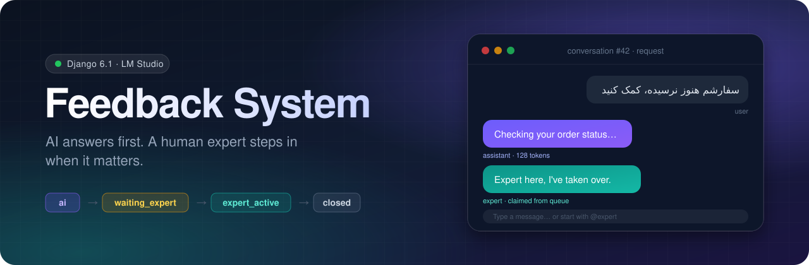
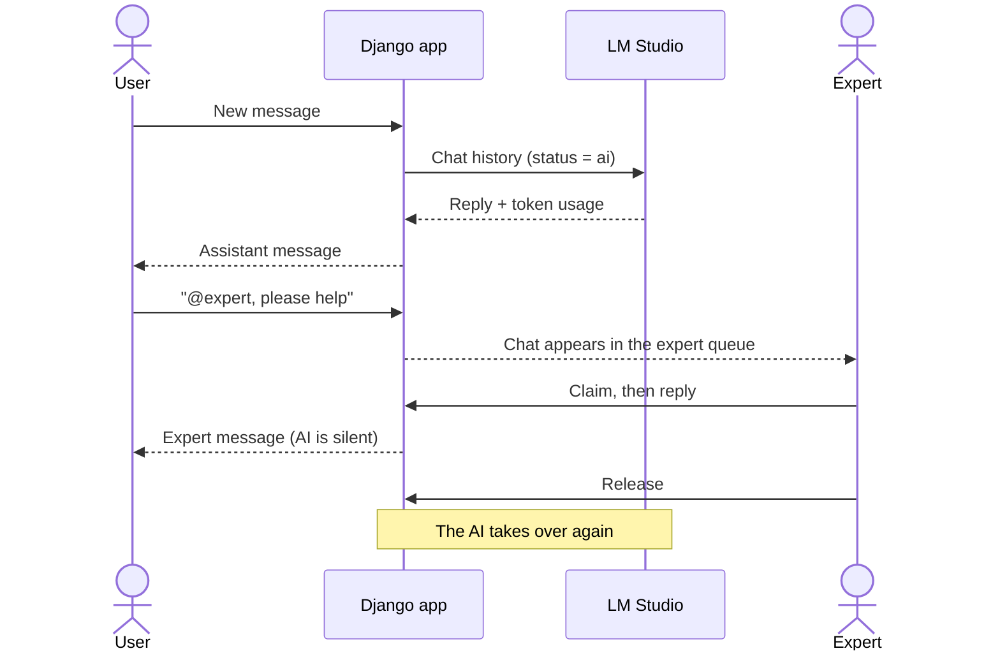
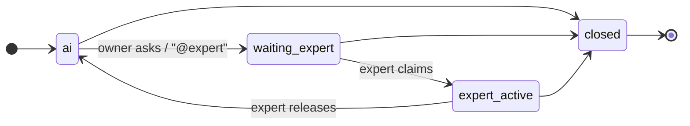

<div align="center">



<br>


[](https://github.com/Yad-Tazheh/feedback-system/actions/workflows/ci.yml)


**Users open a conversation, a local LLM replies, and a human expert can take over the chat at any time.**

[Specs](#-tech-specs) · [Quick start](#-quick-start) · [How it works](#-how-it-works) · [Roles](#-roles) · [Configuration](#%EF%B8%8F-configuration) · [Production](#-production)

<br>

<a href="#-built-with"></a>
<a href="#-built-with"></a>

</div>

---

## ✨ Features

| | |
|---|---|
| 💬 **Conversations** | Each one has a type (request, criticism, suggestion), a title and an ordered list of messages |
| 🤖 **AI replies** | The chat history goes to any OpenAI-compatible endpoint (LM Studio). A failed call is saved as a failed message, so nothing is lost |
| 🧑‍💼 **Human expert** | Experts claim chats from a queue, answer them and hand them back. The AI stays quiet while an expert holds the chat |
| 📊 **Token usage** | Prompt, completion, cached and total tokens are saved per reply, but only when the provider reports them. Nothing is estimated |
| 🔐 **Accounts** | Sign up, log in, and log out (POST only). Users see only their own chats; anyone else's returns a 404 |
| 🛡️ **Prod-ready settings** | Separate `dev` and `prod` settings, HTTPS, HSTS and secure cookies, and `check --deploy` passes with no warnings |
| 🌐 **Persian UI** | The interface is in Persian (RTL). The code and docs are in English |

## 📋 Tech specs

| Area | Spec |
|---|---|
| 🐍 Language | Python 3.14 (pinned in `.python-version`) |
| 🧱 Framework | Django 6.1, with class-based views and server-rendered templates |
| 📦 Dependencies | `django`, `requests`, `python-dotenv` (that's all), locked in `uv.lock` |
| 🗄️ Database | SQLite, with 9 migrations and indexes on owner/date and conversation/date |
| 🤖 AI | LM Studio, or any OpenAI-compatible `chat/completions` API. Model, temperature, token limit and timeout are set in `.env` |
| 📐 Data model | `Conversation` (type, title, status, owner, expert) → `Message` (role: user / assistant / expert, token usage) |
| 🔄 Workflow | 4-state machine: `ai` → `waiting_expert` → `expert_active` → `closed` |
| 🔐 Auth | Django auth: sign up, log in, POST-only log out. Permissions are checked per object, and anyone else's data returns a 404 |
| 👥 Roles | Owner, Expert (`experts` group), Staff |
| 🛡️ Security | Prod uses HTTPS redirect, HSTS, secure cookies and a proxy SSL header. It won't start without a secret key |
| 🌐 UI | Persian (RTL) |
| 🧪 Tests | 86 Django tests with the AI mocked. GitHub Actions also checks migrations and runs `check --deploy` |

## 🚀 Quick start

> Needs [uv](https://docs.astral.sh/uv/). Python 3.14 is pinned in `.python-version`.

```bash
uv sync
cp .env.example .env            # Windows: copy .env.example .env
uv run python manage.py migrate
uv run python manage.py createsuperuser
uv run python manage.py runserver
```

Open **http://127.0.0.1:8000/** and sign up, or log in as the superuser.

### Connect LM Studio

1. Load a chat model in LM Studio (the example config uses `qwen2.5-7b-instruct`).
2. Start the local server (port 1234 by default).
3. In `.env`, set `LM_STUDIO_URL=http://localhost:1234/v1/chat/completions` and set `LM_MODEL` to the model id.

> 💡 If LM Studio is down, the conversation is still saved and the failure is recorded on the message.

## 🔄 How it works



### Conversation states



| State | Meaning | AI replies? |
|---|---|:---:|
| `ai` | The AI answers user messages | ✅ |
| `waiting_expert` | Waiting in the expert queue | ❌ |
| `expert_active` | An expert holds the chat | ❌ |
| `closed` | Final state; no new messages | ❌ |

Invalid transitions raise a `ValidationError`.

## 👥 Roles

| Role | Who | Can |
|---|---|---|
| 👤 Visitor | Not logged in | Sign up, log in |
| 🙋 Owner | Any logged-in user, for their own chats | Create, edit and delete own chats; post; ask for an expert while the chat is `ai` |
| 🧑‍💼 Expert | Member of the `experts` group | See the queue; claim waiting chats (not their own); post in chats they hold; release or close them |
| 🛠️ Staff | `is_staff` | See every chat, close any open chat, use the admin site |

To make someone an expert, add them to the `experts` group in `/admin/`. A migration creates the group.

## ⚙️ Configuration

<details>
<summary><b>Environment variables</b></summary>

| Variable | Default | Purpose |
|---|---|---|
| `LM_STUDIO_URL` | required | Full chat completions URL |
| `LM_MODEL` | required | Model id sent to LM Studio |
| `LM_TEMPERATURE` | `0.4` | Sampling temperature |
| `LM_MAX_TOKENS` | `150` | Max tokens per reply |
| `LM_TIMEOUT` | `60` | Request timeout in seconds |
| `DJANGO_SETTINGS_MODULE` | `feedback_system.settings.dev` | Which settings module to use |
| `DJANGO_SECRET_KEY` | dev fallback; **required in prod** | Django secret key |
| `DJANGO_ALLOWED_HOSTS` | empty (prod) | Comma-separated host names |
| `DJANGO_CSRF_TRUSTED_ORIGINS` | empty (prod) | Comma-separated origins |
| `DJANGO_SECURE_SSL_REDIRECT` | `True` (prod) | Redirect HTTP to HTTPS |
| `DJANGO_SECURE_HSTS_SECONDS` | `31536000` (prod) | HSTS max-age |
| `DJANGO_EMAIL_BACKEND` | SMTP backend (prod) | Email backend |
| `DJANGO_LOG_LEVEL` | `INFO` | Log level for the `feedbacks` logger |
| `DJANGO_DB_PATH` | `db.sqlite3` | SQLite file path |

Only the AI service loads `.env` (through python-dotenv). Django settings read real environment variables, so export the `DJANGO_*` values in your shell or process manager.

</details>

<details>
<summary><b>URLs</b></summary>

| Path | Name | Purpose |
|---|---|---|
| `/` | `feedback_list` | Your conversations |
| `/create/` | `feedback_create` | New conversation with its first message |
| `/update/<pk>/` | `feedback_update` | Edit type and title (owner) |
| `/delete/<pk>/` | `feedback_delete` | Delete a conversation (owner) |
| `/c/<pk>/` | `conversation_detail` | View and post messages |
| `/c/<pk>/request-expert/` | `conversation_request_expert` | POST: ask for an expert |
| `/c/<pk>/claim/` | `conversation_claim` | POST: expert claims the chat |
| `/c/<pk>/release/` | `conversation_release` | POST: expert hands the chat back to the AI |
| `/c/<pk>/close/` | `conversation_close` | POST: close the chat |
| `/expert/` | `expert_queue` | Expert queue (experts and staff) |
| `/usage/` | `ai_usage` | Your AI token usage |
| `/accounts/signup/` | `signup` | Sign up |
| `/accounts/login/`, `/accounts/logout/` | Django auth | Log in and log out |
| `/admin/` | Django admin | Staff only |

</details>

<details>
<summary><b>Project structure</b></summary>

```
config/prompts/feedback_response.txt   # system prompt for AI replies
feedback_system/
    settings/base.py, dev.py, prod.py
    urls.py, wsgi.py, asgi.py
feedbacks/
    models.py            # Conversation, Message (+ state machine)
    views.py             # class-based views
    permissions.py       # can_view, can_claim, can_close, ...
    services/ai_service.py   # HTTP client for LM Studio
    services/replies.py      # saves OK and failed replies
    migrations/          # 0001 to 0009
    tests.py
templates/feedbacks/     # app pages
templates/registration/  # login, signup, logout
```

</details>

## 🧪 Tests

```bash
uv run python manage.py test
```

The AI calls are mocked, so LM Studio doesn't need to run.

## 🌍 Production

- Set `DJANGO_SETTINGS_MODULE=feedback_system.settings.prod` (`wsgi.py` and `asgi.py` already default to it).
- `DJANGO_SECRET_KEY` is **required**. Also set `DJANGO_ALLOWED_HOSTS` and `DJANGO_CSRF_TRUSTED_ORIGINS`.
- Prod turns off `DEBUG` and turns on the HTTPS redirect, secure cookies and HSTS. It also trusts the `X-Forwarded-Proto` header, so run it behind a reverse proxy that handles TLS.
- Run `manage.py check --deploy` and `manage.py collectstatic`. The proxy serves `/static/`.
- SQLite lives at `DJANGO_DB_PATH`, so keep that file on a persistent volume.

## 📚 Docs

- [ROADMAP.md](ROADMAP.md): sprint goals and review notes
- [design.md](design.md): design decisions for each sprint

## 🤝 Built with


Built in co-op with **Fable 5.2**. The AI writes code together with the developer, and every change is reviewed, tested in CI, and must be explainable.
